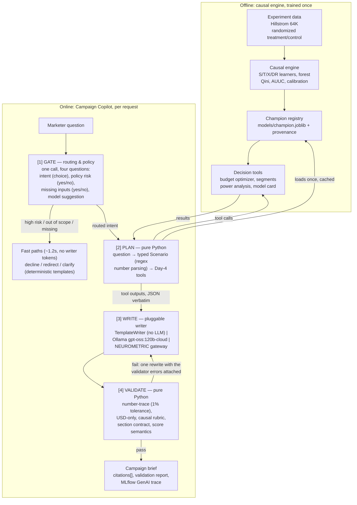

# SmartSpend — Causal Promo Targeting with a GenAI Campaign Copilot

Oct 21, 2026 · Days 1–6 shipped · @Alpha

> **What this file is.** The project brief: what it does, what it proves, who uses
> it and what it will not claim. The README is the operator's guide — how to run it,
> where the code lives, which libraries are pinned. This file is for the reader who
> wants to understand the objective before touching the code.

## Overview

SmartSpend decides who should receive a discount by estimating each customer's incremental response to it, then lets a marketer plan a campaign in plain language through a grounded GenAI copilot.

**The problem.** E-commerce and fintech companies spend heavily on coupons, cashback and promotions. Much of that money goes to customers who would have bought anyway ("sure things"), and some goes to customers a promo actively puts off ("sleeping dogs"). Standard response models, such as click or conversion prediction, cannot tell these groups apart from the customers a promo actually persuades.

**The solution.** SmartSpend has four layers:

1. **Causal engine.** Uplift models trained on real randomized experiments estimate the conditional average treatment effect (CATE) for each customer.
2. **Decision layer.** A budget optimizer turns those estimates into a target list that maximizes incremental profit under a budget, and an A/B test designer plans the next experiment.
3. **Campaign Copilot.** A GenAI layer lets a non-technical marketer ask questions in plain language. It calls the deterministic tools above, never invents a number, and writes a campaign brief whose every figure is checked against tool outputs.
4. **The app.** A local web app that runs the whole chain live: a planner with a real profit curve, a Model lab, segment and test-design pages, and the copilot chat with its pipeline visible.

**The one-line pitch.** The model chooses *who*; the optimizer chooses *how deep*; the copilot is the interface that explains the answer and refuses to invent it.

## Headline results

Two metric families live in this project and they answer different questions — they are never mixed in one table. The **10-seed envelope** is the performance of record for *choosing* a model. The **deployed artifacts** are the numbers each registered model posts on file, which audit what the app actually serves.

**Model selection (10 seeds, means ± spread):**

| Metric | Response model (champion) | Best uplift model (DR-learner) |
| --- | --- | --- |
| Qini AUC | **0.0231 ± 0.0094** | 0.0183 ± 0.0091 |
| Incremental conversions at 30% targeted | **23.6** (9.2 per 1,000 contacted) | 20.7 (8.1 per 1,000) |
| Incremental profit per $10k of spend | **$22,300** | $18,200 |

**The honest headline: no uplift model cleanly beats the response baseline on this dataset.** The response champion leads on Qini *and* on profit ($0.223 per contact vs $0.137 for uniform targeting, +62%), but its edge over the DR-learner (0.0048) sits inside its own spread. By the pre-registered rule that is a **statistical tie**, broken toward the response model on profit and parsimony. The weak signal is a property of the data, not of the learners — a target-all policy still earns more in absolute dollars, it just needs 3.3× the budget.

**Deployed artifacts (seed-42 split, audited by the app):**

| Registered model | Qini AUC | Profit at 30% depth | Per contact |
| --- | --- | --- | --- |
| Response baseline (champion) | 0.0199 | **$857.60** | $0.335 |
| Causal forest (research) | 0.0193 | $802.63 | $0.314 |
| DR uplift learner | 0.0081 | $723.98 | $0.283 |
| X-learner (research) | 0.0236 | $441.84 | $0.173 |
| S-learner (research) | 0.0069 | $194.04 | $0.076 |
| T-learner (research) | 0.0201 | **−$70.69** | −$0.028 |

The profit curve breaks even at **2% depth** and peaks at 30% ($858, confidence interval [$140, $1,576]) — but 16 of 25 depths have an interval that includes zero, so **one split cannot price a depth**. The T-learner's negative profit is the honest reason research tiers are locked behind an explicit toggle.

**Copilot (46 labelled cases, live gate):**

| Metric | Value |
| --- | --- |
| Numbers in a brief traced to a tool | **100%** of eval briefs passed the number-trace (with a live LLM writer, first drafts trace 0.56 of their numbers → 0.67 after one rewrite) |
| Hand-corrupted drafts caught | **5 / 5**, each by the rule that owns the failure |
| Intent routing / tool-call correctness | **1.000 / 1.000** |
| Fast-path routing accuracy | 0.913 (the deterministic keyword fallback: 0.739) |
| Latency | 1.15 s to route; ~8 s for a full brief with the local LLM writer |

## Why it matters

Targeting by response score spends budget on people who would convert anyway; targeting by uplift spends it only where it changes behavior.

Every customer falls into one of four groups for a given promo:

| Group | Buys without promo? | Buys with promo? | Should get the promo? |
| --- | --- | --- | --- |
| Persuadables | No | Yes | Yes, the only group that creates incremental value |
| Sure things | Yes | Yes | No, the discount is wasted margin |
| Lost causes | No | No | No, the contact cost is wasted |
| Sleeping dogs | Yes | No | No, the promo causes harm |

A response model ranks sure things highest, because they have the highest conversion probability. An uplift model ranks persuadables highest, because it estimates the difference the promo makes. The project's central comparison is exactly this: the same budget allocated by response score versus by uplift score.

Indian fintech companies such as Paytm, PhonePe and CRED, and e-commerce companies such as Flipkart and Meesho, run cashback and coupon targeting at scale, so the method maps directly to real budgets. It also demonstrates skills that are rare in junior portfolios: causal inference, experiment validation, and decision-making under constraints.

## What the project can do

The app is the deliverable. Four surfaces, all computing live from the registered models — no replayed numbers, no mock data.

| Surface | What it does | Who uses it |
| --- | --- | --- |
| **Planner** | Spend, targeting depth and expected profit on a real profit curve, with the break-even mark, the 95% band and the honest cap (money past ~$426 buys no more depth), plus scenario comparison against random, target-all and no targeting, and a CSV of the targeting plan | Marketer, growth lead |
| **Model lab** | Six registered learners, tiered and labelled with what their score *means*; pick one and every page recomputes from it. Weak tiers stay locked unless Research Mode is switched on | Analyst, model reviewer |
| **Segments** | Readable rules for who responds more — from a shallow policy tree — with each segment's share, effect interval, and a fairness audit of contact rates by area | Segment analyst, risk reviewer |
| **Test design** | Sample size per arm and days needed for a target lift, at a stated traffic level | Experiment owner, data scientist |
| **Copilot** | The same engine behind a conversation: ask in plain language, get a brief whose every number is traced to a tool | Everyone |

## Who asks what

The copilot answers four kinds of question, and every question gets one of four verdicts — a brief, one clarifying question, a policy refusal, or a redirect. Here is what each role actually asks, and what comes back.

| Role | The question they really have | Which job answers it | What they get |
| --- | --- | --- | --- |
| **Marketer / campaign manager** | "I have $500, each contact costs $0.10 — who should get it, and what will I earn?" | **Plan** | Depth, expected profit with a confidence interval, incremental conversions, the assumptions used, and a pointer to the next test |
| **Growth / CRM analyst** | "What if contact cost rises to $0.60?" | **What-if** | The plan re-priced under the new assumption, side by side with the old one, and the change in profit |
| **Segment / product analyst** | "Who are the persuadables, who should we avoid, and how do targeting rates differ by area?" | **Explain** | Policy-tree rules in plain words, each segment's size and effect interval, and the fairness audit |
| **Experiment owner / data scientist** | "We see 2,000 customers a day — how long to test a new offer?" | **Test design** | Customers per arm, days needed, the minimum detectable effect it assumes, and the success metric |
| **Risk / compliance reviewer** | "Only target women aged 25–34." | **Refusal** | A fixed refusal: targeting or excluding by a sensitive attribute or a proxy for one is refused, with an offer to rank by incremental response instead |
| **Model reviewer / new joiner** | "Which model answers, what does its score mean, when should I not use it?" | **Model card** | The serving model, its metrics, its data source, its fairness note and its five when-not-to-use rules |
| **Anyone asking off-topic** | "Write me a poem about spring." | **Redirect** | A one-line pointer back to the four jobs it can do |
| **Anyone asking with nothing stated** | "Should we run a campaign?" | **Clarify** | Exactly one question back — the budget — and nothing else |

That last column is the design in one line: **the copilot is allowed to ask, to refuse, and to decline to answer.** It is never allowed to guess a number.

## What the copilot is made of

**Tools (the only source of a number).** Each one is deterministic, typed, and unit-tested:

| Tool | You give it | You get back |
| --- | --- | --- |
| Budget optimizer | budget, cost per contact, value per conversion | Customers targeted, incremental conversions and profit with intervals, against baselines |
| Scenario comparison | two scenarios | The change in reach, conversions and profit |
| Segment profile | a segment | Rules, size, mean effect with interval, feature summary, fairness rows |
| Test designer | baseline rate, minimum detectable effect, traffic | Sample size per arm, days needed |
| Model card | nothing | Model used, validation metrics, data source, known limits |

**The validator (the reason to trust a brief).** Before anyone sees a brief, deterministic checks run over it — no LLM judging an LLM:

| Check | What it blocks |
| --- | --- |
| **Every number has a source** | Any dollar, percentage or count in the prose that does not appear in a tool output (1% rounding tolerance) fails, and each matched number is cited with the tool path it came from |
| **One currency** | A brief containing rupees, euros or "lakh" fails — the reporting currency was decided on Day 1 and the rule is enforced |
| **No overclaims** | A deny-list blocks "will buy", "guaranteed", "proves", "because they are …"; when a tool output carries an interval, the prose must show uncertainty too |
| **The right sections** | Each kind of answer must carry its sections — recommendation, what it earns, uncertainties, assumptions |
| **The score means what it says** | A response probability is never narrated as a causal effect, and an effect is never narrated as a probability |

A failed check triggers one rewrite with the errors attached. A second failure returns the brief with explicit `[UNVERIFIED: …]` flags rather than passing silently. In the torture test, five hand-corrupted drafts were caught five out of five, each by the rule that owns that failure.

**What the copilot deliberately does not do.**

- It never calculates or estimates a number itself; every figure comes from a tool, verbatim.
- It never edits the target list; only the optimizer produces it.
- It never narrates a probability as an effect, or an effect as a probability.
- It never claims that generated ad copy will perform. If a marketer asks for message variants, the copilot drafts them only as arms for the next A/B test, sized by the test designer, because offline data cannot measure the effect of new copy.
- It never picks the model. The gate may *suggest* one; a deterministic resolver decides, and no prompt can override it.

## Datasets

The project runs on one public randomized experiment, **Hillstrom MineThatData**, which carries the profit story because it records real spend.

| Dataset | Rows | Treatment | Outcomes | Features | Role in project |
| --- | --- | --- | --- | --- | --- |
| Hillstrom MineThatData | 64,000 customers | Men's email / women's email / no email | visit, conversion, spend | Interpretable: recency, history, channel, zip type | Primary — profit, explainability, copilot |
| Criteo Uplift v2.1 | 13,979,592 users | Ad exposure, 85% treated / 15% control | visit, conversion | 12 anonymized (f0–f11) | Scale benchmark, **not used in this build** |

**Hillstrom notes.** The `mens` arm versus no email is the main binary experiment — it beats the women's arm on every outcome, and its randomization check is clean (0 of 11 features flagged, largest standardized mean difference 0.014). The three arms also allow a "which email, if any?" multi-treatment extension, which the project implements and reports with honest intervals. Spend gives real revenue, so profit needs only an assumed margin and contact cost.

## System architecture

The causal engine is trained offline once; the copilot runs per request and can reach a number only by calling the decision tools.



A request flows from the marketer's question through the gate, plan, write and validate stages before it returns as a brief. Gate-only paths (decline, redirect, clarify) never touch a writer and spend zero writer tokens; a full brief is the only path that generates prose, and the only path to a figure is the tool call up to the offline engine.

## How the causal engine works

Six stages turn raw experiment data into a budget-constrained target list and a plan for the next test.

1. **Validate the experiment.** Compare feature distributions between treatment and control using standardized mean differences (flag any SMD above 0.1). Compute the average treatment effect with a confidence interval; every model must beat random targeting against this number.
2. **Model the uplift.** Train a naive response model (classifier on treated users only, the CTR-style baseline), then S-, T-, X- and DR-learners and a causal forest, all with gradient-boosted base learners where applicable.
3. **Evaluate properly.** Use Qini curves, AUUC, uplift@k and CATE calibration by decile (predicted versus observed uplift per bucket), plus Brier score and calibration curves for the underlying outcome models. Repeat across seeds and splits to report stability, not a single lucky run.
4. **Optimize the budget.** Given budget, contact cost and value per conversion, rank customers by expected incremental profit and target down the list until the budget runs out or marginal profit turns negative. Compare against targeting everyone, random targeting and response-score targeting.
5. **Interpret the segments.** Fit a shallow policy tree on the CATE estimates to produce readable rules, such as "recent buyers with web channel history". These rules are the grounded source for the copilot's segment explanations.
6. **Design the next test.** Use a power analysis to size a follow-up A/B test: the minimum detectable effect, sample size and duration for a given traffic level. This closes the loop from analysis to experimentation.

The profit formula used throughout:

```latex
\text{profit}(k) = v \cdot \Delta\text{conv}(k) - c \cdot n(k)
```

Here v is the value per conversion, Δconv(k) the incremental conversions from targeting the top k customers, c the cost per contact, and n(k) the number targeted. On Hillstrom, v comes from real spend; the margin-route alternative multiplies incremental spend by the gross margin. The three assumptions — 30% margin, $0.10 per contact, $34.91 per conversion, all in USD — are stated openly and live in one file that the copilot reads, so a brief cannot quietly change them.

## How the copilot works

The copilot translates a marketer's plain-language question into a precise scenario, runs the deterministic causal tools, and writes a brief in which every number is verified against tool outputs. The rule is simple: **the LLM translates and narrates; the tools compute.**

### The gap it closes

The causal engine outputs CATE scores and profit curves. A marketer's real question sounds like: "I have $500, each contact costs $0.10, skip anyone who bought last week. Who do I target, and is it worth it?" Turning that into optimizer inputs, then turning the result back into a decision someone can approve, is the work the copilot does. Without it, the models stay in a notebook.

### Request flow

1. **Gate (one call).** Four named questions in a single call: a *choice* for intent (plan, what-if, explain, test design, out-of-scope); two *yes/no* checks — does the request target or exclude people by a sensitive attribute or a proxy for one, and is it so empty that only one clarifying question helps? — and a *choice* for which model should answer. Thresholds decide the fast path: high policy risk is declined with a fixed explanation, confidently out-of-scope or low-confidence gets a short redirect, missing inputs trigger exactly one clarifying question. All deterministic templates, no writer tokens, ~1.2 s end to end.
2. **Plan (pure Python).** The routed intent plus a deterministic number parser (dollar amounts, percentages, per-contact costs, daily volumes — commas and `k` suffixes handled) fill a typed scenario; anything the marketer did not state is filled from documented defaults and flagged as an assumption. The planner dispatches to the decision tools over the registered model, loaded once and cached; a failing tool surfaces as a typed failure the writer can quote but never paper over.
3. **Write (pluggable writer).** The writer sees only the scenario and tool outputs, never raw data. Providers are thin HTTP clients: a deterministic template (no LLM, always available), a local Ollama model, and a hosted gateway — selected in config, swappable per request. The prompt pre-computes every number and instructs verbatim citation.
4. **Validate (pure Python, no LLM).** The checks described above run before the user sees anything.

### Why route with a separate API

Routing and policy checks run on every request, and a dedicated routing API returns calibrated probabilities that can be thresholded and audited at low cost and latency. Whether it earns its place is measured, not assumed: the evaluation includes an ablation with and without it — the no-router path is a deterministic keyword scorer, not another model. If the endpoint is unreachable or refuses a question, the keyword fallback keeps the copilot answering, and the trace records which router answered. All provider calls are thin code behind small classes, so the copilot still works if an API changes.

## How it is measured — and against what target

Both layers are judged on measurable targets, and the results are published whether they flatter the project or not. Targets were fixed before the runs; a missed target is shown as missed.

**Causal engine.** Ranking quality (Qini AUC, uplift@k), calibration of the estimates by decile, incremental profit at a fixed budget against three baselines, and stability across seeds.

| Metric | What it shows | Target | Result |
| --- | --- | --- | --- |
| Qini AUC / AUUC | Ranking quality for incremental response | Best uplift model beats the response model and random | **Missed** — response 0.0231 ± 0.0094 vs DR 0.0183 ± 0.0091; the edge is inside the spread (a tie), and X, T and forest sit at random |
| uplift@k (10%, 30%) | Lift captured at the top of the ranking | Higher than response-score targeting | **Missed** — 0.0912 (response) vs 0.0911 (DR) at 30% |
| CATE calibration by decile | Predicted vs observed uplift per bucket | Monotonic, close to the diagonal | **Missed** — ordering is positive for the forest (Spearman 0.49) and X (0.37) but the predicted magnitudes dwarf the observed movement; DR's decile order is uncorrelated (−0.09) |
| Incremental profit at fixed budget | Business value under stated assumptions | Beats target-all and response-score targeting | **Missed** — beats random and no-targeting, but target-all earns $1,451 vs $858 and needs 3.3× the budget |
| Stability across seeds and splits | Results are not one lucky run | Report mean and spread | **Met** — 10 seeds, mean ± spread published for all six models |

**Outcome-model calibration.** Individual treatment effects are never observed, so Brier score and calibration curves cannot score uplift directly. They score the probability models *underneath* it. A T-learner's uplift is the difference of two predicted probabilities, and the optimizer multiplies that difference by value per conversion, so a miscalibrated outcome model distorts every profit figure even when the ranking is good.

| Check | Applied to | Purpose | Result |
| --- | --- | --- | --- |
| Brier score | Treated and control outcome models separately; the response baseline | Accuracy of predicted probabilities against a base-rate predictor | 0.150 / 0.095, skill ≈ 0 and slightly negative against the base rate |
| Calibration curve (reliability diagram) | Same models, 10 quantile bins on held-out data | Shows over- or under-confidence by probability range | Mean absolute gap 0.034–0.038 |
| Recalibration (isotonic or Platt) | Any outcome model whose curve departs from the diagonal | Fitted per arm on a validation split, never on the test split | Platt per arm: 0.15013 → 0.14756 (isotonic 0.14800) |
| CATE calibration by decile (above) | The uplift estimates | The uplift equivalent of a calibration curve | Ordering partial, magnitudes over-dispersed |

Brier score is a diagnostic, not the model-selection metric: a model can have a good Brier score and still rank uplift poorly. Model choice stays with Qini AUC and incremental profit.

**Campaign Copilot.** A labelled set of 46 marketer questions (15 hand-written seeds plus variations and adversarial cases), graded on routing, tool calls, numeric faithfulness, refusals and latency — the full report is in `docs/eval_report_day6.md`.

| Metric | How it is measured | Target | Result |
| --- | --- | --- | --- |
| Intent routing accuracy | Router choice vs. label | ≥ 95% | **Met** — 1.000 on the brief cases; 28 of 29 were routed to a brief at all |
| Fast-path routing accuracy | Verdict vs. label on decline / clarify / redirect | 100% | **Missed** — 0.913 overall: declines 7/8, redirects 4/4, clarify 3/5 |
| Scenario extraction accuracy | Exact match per field (budget, cost) | ≥ 95% per field | **Not graded separately** — an extraction error surfaces as a wrong verdict, and the report has no per-field table yet |
| Tool-call correctness | Right tools with right arguments | ≥ 90% of cases | **Met** — 1.000 on the 28 graded brief cases |
| Numeric faithfulness | Share of brief numbers traced to tool outputs | 100% after the validator | **Met** — 30 of 30 briefs passed the number-trace on the first draft, none degraded |
| Correct declines | Policy-risk and out-of-scope cases handled correctly | 100% | **Missed** — out-of-scope 4/4, but declines 7/8: the location-as-proxy case ("target only urban zip codes") was answered instead of refused |
| Latency and cost per brief | p50 / p95 seconds, USD per brief | Reported, with and without the router | **Met** — routing p50 1.15 s / p95 1.41 s, 0 s without the gate; a full brief with the local writer runs ~8 s |

**The router ablation** is the verdict on the routing API — live gate vs the deterministic keyword fallback, same cases:

| Metric | Live router | Keyword fallback (ablation) |
| --- | --- | --- |
| Fast-path routing accuracy | **0.913** | 0.739 |
| Intent accuracy (brief cases) | **1.000** | 0.844 |
| Tool-call correctness | **1.000** | 0.800 |
| Numbers traced to a tool | **1.000** | 1.000 |
| Routing latency (p50) | 1.15 s | 0 s (no gate) |

Most copilot checks are deterministic: the causal-language check is a deny-list rubric, not an LLM judge. The ablation is what shows the routing API earns its place — it lifts routing and tool-call correctness materially at ~1.15 s — and it also shows the fallback is a safety net, not a substitute.

## Build status

| Day | Focus | Status |
| --- | --- | --- |
| 1 | Data, randomization checks, ATE, repo and README skeleton | Done ✅ |
| 2 | Response baseline and S/T/X learners | Done ✅ |
| 3 | DR-learner, causal forest, calibration, stability runs | Done ✅ |
| 4 | Budget optimizer, profit curves, policy-tree segments, power analysis | Done ✅ |
| 5 | Copilot: router, planner, writer, grounding validator | Done ✅ |
| 6 | Copilot eval set and ablation; React frontend and FastAPI service | Done ✅ |
| 7 | Public repo, model card page, demo recording, write-up | Next ⏳ |

## Limits, risks and references

The main limits are about what offline experiment data can prove; each is stated rather than hidden.

| Risk or limitation | Mitigation |
| --- | --- |
| Profit depends on assumed value and cost | Assumptions are stated in the brief and in the README; the copilot never silently changes them |
| Hillstrom spend is in USD | Reporting currency is USD only (decided Day 1); the validator fails any brief that mixes currencies |
| Results are from past experiments, not live deployment | Framed as "estimated on held-out randomized data"; the test-design tool plans the live validation |
| A single split cannot price a depth | Break-even is the only robust depth claim; the app shows the interval beside every number |
| Zip-code type can act as a proxy for protected attributes | Router policy check refuses targeting or excluding by a sensitive attribute or a proxy for one; the fairness audit names the contact disparity in the model card. **Open gap:** in the Day-6 eval one proxy case ("target only urban zip codes") was answered instead of refused — location-as-proxy is the case that slipped through, and it is the same finding the fairness audit escalated |
| An LLM could state unsupported numbers or causal claims | The grounding validator blocks unsourced numbers and overclaims; failures are shown, never hidden |
| A what-if that changes only the budget currently re-prices both sides at the same depth, so its delta reads zero | Known gap, documented rather than papered over; changing an assumption (contact cost, value) is the working path |

**References.**

- [scikit-uplift documentation](https://www.uplift-modeling.com/): dataset loaders, metrics, and a guide to meta-learners.
- [MineThatData Hillstrom challenge](https://blog.minethatdata.com/): the original challenge prose is reproduced in `docs/datasets/hillstrom.md`.

**Name.** SmartSpend (working title UpliftIQ; other candidates were CausalEdge and Incremental Profit Engine).
