# SmartSpend — Causal Promo Targeting with a GenAI Campaign Copilot

<a href="https://www.python.org/"></a>
<a href="https://fastapi.tiangolo.com/"></a>
<a href="https://react.dev/"></a>
<a href="https://www.typescriptlang.org/"></a>
<a href="https://tailwindcss.com/"></a>
<a href="https://vite.dev/"></a>
<a href="https://mlflow.org/"></a>
<a href="https://www.sqlite.org/"></a>

<a href="https://docs.astral.sh/uv/"></a>
<a href="https://nodejs.org/"></a>
<a href="https://pnpm.io/"></a>
<a href="https://www.uplift-modeling.com/"></a>
<a href="https://github.com/uber/causalml"></a>
<a href="https://github.com/pycausal/py-EconML"></a>
<a href="https://lightgbm.readthedocs.io/"></a>
<a href="https://docs.pytest.org/"></a>
<a href="https://docs.astral.sh/ruff/"></a>
<a href="https://mypy-lang.org/"></a>
<a href="https://jupyter.org/"></a>

Decide **who should get a discount** by estimating each customer's *incremental*
response to it (CATE / uplift), then let a marketer plan a campaign in plain
language through a grounded GenAI copilot — with every number in the answer
computed by code and traced back to the model that produced it.

> **Read the blog post** → [The Prompt Said Don't Derive Numbers. The Model
> Derived Them Anyway.](https://medium.com/@nike.yoyo234/the-prompt-said-dont-derive-numbers-the-model-derived-them-anyway-2e82ef1a06a4)
> — on grounding an LLM product by moving every decision that matters out of the
> model and into ordinary Python.
>
> **Name:** SmartSpend (working title: UpliftIQ; other candidates: CausalEdge,
> Incremental Profit Engine) · **Repo directory:** `SmartSpend`
> **Status:** Days 1–6 shipped, Day 7 in progress → [`ROADMAP.md`](ROADMAP.md)
> **Project brief** (objective, capabilities, who asks what) → [`PROJECT.md`](PROJECT.md)
> **Concepts + every measured number** → [`docs/concepts.md`](docs/concepts.md)

---

## Contents

- [What it does](#what-it-does) — the five screens, with real screenshots
- [The problem in one line](#the-problem-in-one-line)
- [Quick start](#quick-start) — prerequisites, one command, troubleshooting
- [How it works](#how-it-works) — architecture, the model catalog, the copilot's contract
- [What the measurements show](#what-the-measurements-show) — the evidence, figure by figure
- [What the app serves](#what-the-app-serves) — the live numbers, page by page
- [Assumptions](#assumptions) — the money behind every profit figure
- [Repo layout](#repo-layout) — where everything lives
- [Tech stack](#tech-stack)
- [API reference](#api-reference)
- [Testing and quality gates](#testing-and-quality-gates)
- [Limitations, risks and known gaps](#limitations-risks-and-known-gaps)
- [What's next](#whats-next)
- [Data and references](#data-and-references)

---

## What it does

A local web app (FastAPI + React) that runs the whole chain live — no replayed
numbers, no mock data, no fallback when the API is down.

| Screen | What it does | Who uses it |
| --- | --- | --- |
| **Planner** | Spend, targeting depth and expected profit on a real profit curve, with the break-even mark, the 95% band, a scenario comparison against random / target-all / no-targeting, and a CSV of the targeting plan | Marketer, growth lead |
| **Model lab** | Six registered learners, each labelled with what its score *means*; pick one and every other page recomputes from it. Weak tiers stay locked unless **Research Mode** is switched on | Analyst, model reviewer |
| **Segments** | Readable rules for who responds more (a shallow policy tree), each segment's share and effect interval, plus a fairness audit of contact rates by area | Segment analyst, risk reviewer |
| **Test design** | Customers per arm and days needed for a target lift, at a stated traffic level | Experiment owner, data scientist |
| **Copilot** | The same engine behind a conversation: ask in plain language, get a brief whose every number is traced to a tool — with the pipeline (gate → plan → write → validate) and its real timings on screen | Everyone |

### The planner

One lever, three units: money, targeting depth and contact count are the same
knob. Drag either slider and the profit curve, the scenario table and the CSV
follow.

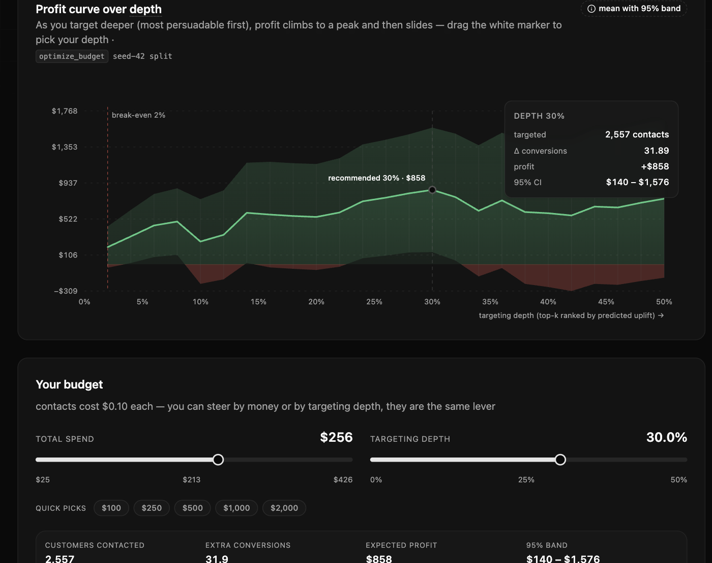

### The model lab

Six ranking models, each trained once on the same holdout, each with its tier,
its score meaning and the honest 10-seed reading. Research-only tiers are
listed and locked, never hidden.

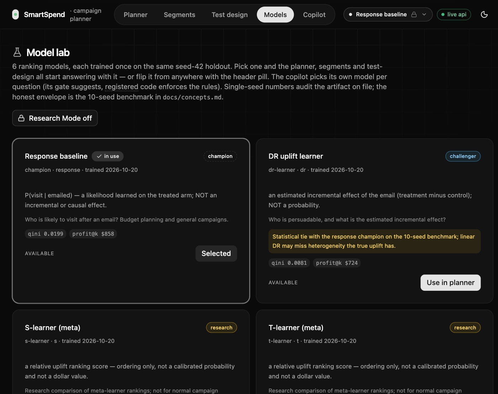

### The segments and the fairness audit

The policy tree's rules, each segment's holdout-graded uplift with its interval,
and — right below — who actually gets contacted. The contact disparity is real
and the page says so.

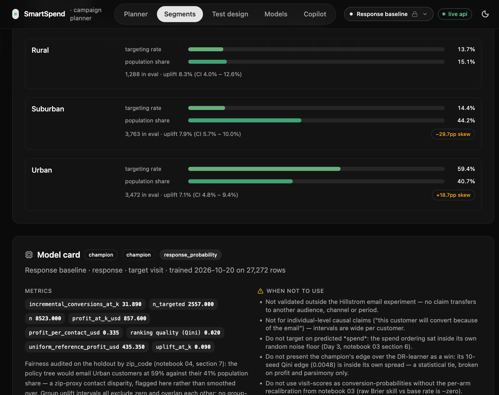

### The copilot

A real answer, in 6.32 s: the question, the brief, the five validation checks
passing, and the twelve numbers traced back to tool outputs.

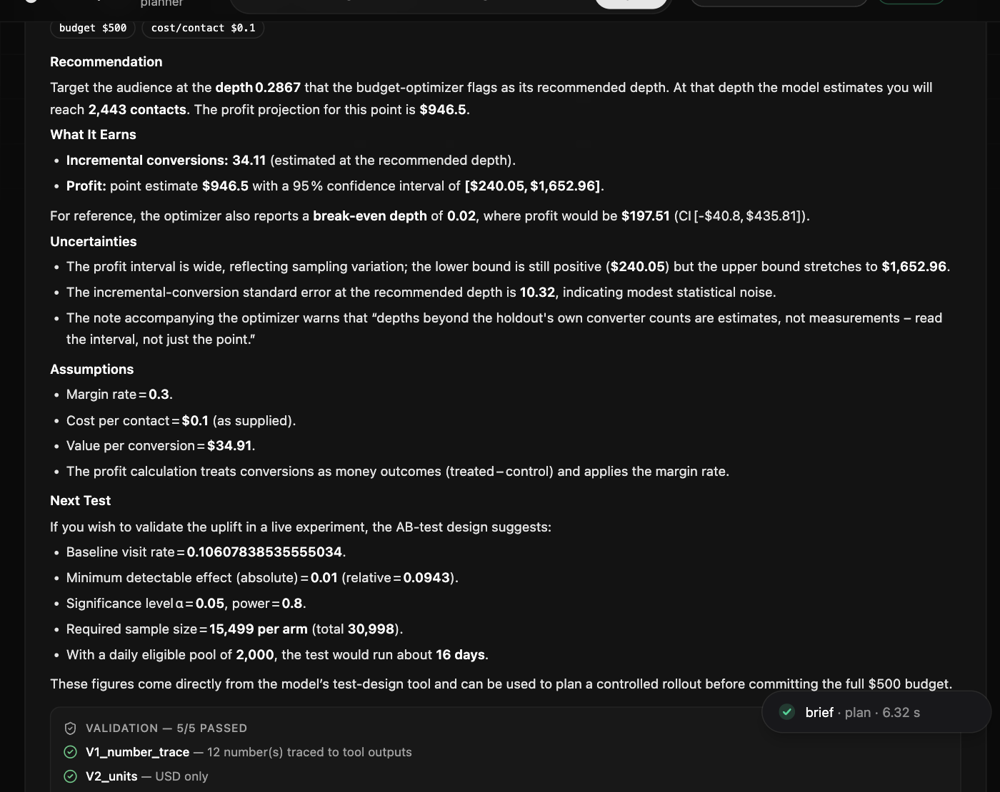

### What the copilot can do

Four jobs, four verdicts. Every answer is a brief, one clarifying question, a
policy refusal, or a redirect — the copilot never guesses a number.

| Job | Example question | What you get |
| --- | --- | --- |
| Plan a campaign | "I have $500 to spend on contacts at $0.10 each — how deep should I target and what should I expect to earn?" | Depth, expected profit with a confidence interval, assumptions used, a next-test pointer |
| What-if | "What if contact cost rises to $0.60?" | The plan re-priced under the new assumption, side by side with the old one |
| Explain the model | "Who are the persuadables and who should we avoid targeting?" | Policy-tree rules in plain words, segment sizes and effect intervals, fairness rows |
| Size a test | "We see 2,000 customers a day — how long should we test a new offer?" | Customers per arm, days needed, the assumed minimum detectable effect |

It **refuses** targeting or excluding people by a sensitive attribute or a proxy
for one, **asks one question back** when a request has nothing stated, and
**redirects** anything outside those four jobs. The full capability map — which
role asks what — is in [`PROJECT.md`](PROJECT.md) § "Who asks what".

---

## The problem in one line

Standard response models (click / conversion prediction) rank **"sure things"**
highest — customers who would have bought anyway — so budget is spent on discounts
that change nothing. An uplift model ranks **persuadables** highest instead.

| Group | Buys without promo? | Buys with promo? | Target? |
| --- | --- | --- | --- |
| Persuadables | No | Yes | **Yes** — the only incremental-value group |
| Sure things | Yes | Yes | No — wasted margin |
| Lost causes | No | No | No — wasted contact cost |
| Sleeping dogs | Yes | No | No — the promo causes harm |

The project's central comparison is exactly this: **the same budget allocated by
response score versus by uplift score**, measured on a real randomized experiment.

---

## Quick start

### Prerequisites

| Tool | Version | Why |
| --- | --- | --- |
| Python | **3.11** (pinned in `.python-version`) | `causalml` and `econml` have no 3.13 support — this is why the pin exists |
| [`uv`](https://docs.astral.sh/uv/) | latest | environment + dependency management |
| Node + pnpm | 22 / 10 (pinned in `mise.toml`) | the React frontend |

### One command

```bash
uv sync                              # create .venv and install everything
uv run python pipelines/download.py  # fetch the raw Hillstrom CSV if missing, then verify
uv run python pipelines/train_all.py # train + register all six catalog models (skips existing)
npm run start                        # FastAPI :8000 + web :5173
```

Then open <http://localhost:5173>. `npm run setup` does all of the above
idempotently (mise → `uv sync` → `pnpm install` → `.env` → data → all six models
→ Alembic → MLflow → smoke test).

### What each command does

| Command | What it does |
| --- | --- |
| `uv sync` | creates `.venv` from `uv.lock` (CI uses `--frozen`) |
| `uv run python pipelines/download.py` | fetches the raw Hillstrom CSV if it is missing, verifies its SHA-256, `--verify-only` stays offline, `--force` re-downloads |
| `uv run python pipelines/train_all.py` | fits and registers the six catalog models (idempotent — existing valid artifacts are skipped); `--force` retrains, `--only <name>` fits one |
| `npm run start` | boots FastAPI on :8000 and Vite on :5173 via `scripts/start_app.sh` |
| `npm run mlflow` | serves the local MLflow UI on :5000 (the GenAI → Traces view is the copilot's audit trail) |
| `npm run delete` | destructive reset of the local state (keeps `.env` and lockfiles); `--dry-run` / `--yes` |
| `npm run web:check` | frontend gates: lint → typecheck → test |
| `uv run jupyter lab` | opens `research/notebooks/` |

### Ports are strict and self-healing

`npm run start` is safe to re-run: it frees a stale SmartSpend listener left by
a suspended run (a stopped uvicorn still holds :8000 but never answers, which
looks like a proxy timeout), reuses a healthy stack that is already up, and
refuses a port held by any other program. Vite runs with `strictPort`, so :5173
never silently becomes :5175.

### Troubleshooting

| Symptom | Cause | Fix |
| --- | --- | --- |
| `pnpm: command not found` | mise shims not on PATH | `export PATH="$HOME/.local/bin:$HOME/.local/share/mise/shims:$PATH"` |
| The first page load takes ~20 s | the app warms the champion's policy tree in the background | wait; the second load is instant |
| A model switch shows a "loading …" veil | the next model's payload is not cached in this process yet | wait for it; a cold model is computed once, then cached |
| The header badge says `api offline` | the API is not answering | the app shows **no fallback data** by design — fix the API, not the page |
| `pytest` skips the data-dependent tests | the raw CSV is missing | `uv run python pipelines/download.py` |

---

## How it works

### System at a glance

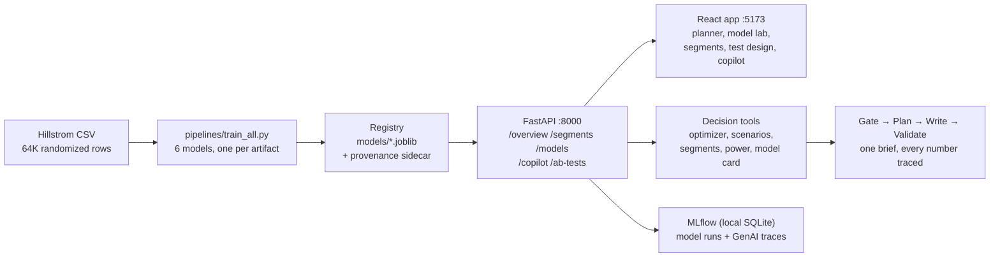

Two rules hold it together. **The API never trains** — it only loads registered
artifacts, and an artifact whose sidecar does not state its score semantics
cannot load at all. **The LLM never computes** — the writer sees tool outputs and
narrates them; a validator traces every number in the prose back to a tool
before the brief reaches you.

### The model catalog

The single source of serving truth is `packages/causal/catalog.py`. Pick a model
in the header and the whole app recomputes from it.

| Model | Tier | Score kind | Intervals | Research-only | Use it for |
| --- | --- | --- | --- | --- | --- |
| `champion` — Response baseline | champion | `response_probability` (P(visit \| treated)) | no | no | budget plans; ranking a "sure-thing" list on purpose |
| `dr-learner` — DR uplift learner | challenger | `uplift_effect` | no | no | effect answers; a statistical tie with the champion |
| `s-learner` | research | `relative_uplift` | no | **yes** | research comparisons only — Qini sits inside random noise |
| `t-learner` | research | `relative_uplift` | no | **yes** | research only — benchmarked at random, and it loses money |
| `x-learner` | research | `relative_uplift` | no | **yes** | research only — benchmarked at random |
| `causal-forest` | research | `uplift_effect_interval` | **yes** | **yes** | effect *ranges* under Research Mode; an interval is uncertainty, not a promise |

Research Mode is a deliberate unlock, recorded on every copilot request and on
every MLflow trace. It never changes the numbers the tools compute — only who
is allowed to ask.

### The copilot's contract

A question can only become fields the tools accept; anything else is a
validation error, not a guess.

```python
from typing import Literal
from pydantic import BaseModel, Field

class CampaignScenario(BaseModel):          # packages/copilot/schemas.py
    intent: Literal["plan", "what_if", "explain", "test_design"]
    question: str
    budget_usd: float | None = Field(default=None, gt=0)
    cost_per_contact_usd: float | None = Field(default=None, gt=0)
    depth: float | None = Field(default=None, gt=0, le=0.5)
    mde: float | None = Field(default=None, gt=0)
    daily_eligible: int | None = Field(default=None, gt=0)
    assumptions_used: list[str] = []        # every default, shown in the brief
```

The five decision tools are the only source of a number: `optimize_budget`,
`compare_scenarios`, `get_segment_profile`, `design_ab_test`,
`get_model_card`. Each is deterministic, typed, and unit-tested.

The validator is the reason to trust a brief — deterministic checks, no LLM
judging an LLM:

| Check | What it blocks |
| --- | --- |
| Every number has a source | any dollar, percentage or count in the prose that does not appear in a tool output (1% tolerance); each matched number is cited with its tool path |
| One currency | a brief containing rupees, euros or "lakh" — the reporting currency was decided on Day 1 and the rule is enforced |
| No overclaims | a deny-list blocks "will buy", "guaranteed", "proves", "because they are …"; when a tool output carries an interval, the prose must show uncertainty too |
| The right sections | each kind of answer must carry its sections — recommendation, what it earns, uncertainties, assumptions |
| The score means what it says | a response probability is never narrated as a causal effect, and an effect is never narrated as a probability |

A failed check triggers one rewrite with the errors attached; a second failure
returns the brief with explicit `[UNVERIFIED: …]` flags rather than passing
silently.

---

## What the measurements show

Everything below is reproducible from a notebook or script and is recorded with
its source in [`docs/concepts.md`](docs/concepts.md) (the findings ledger).

> **Two metric families, never mixed.** The **10-seed envelope** is the result of
> record for *choosing* a model. The **seed-42 sidecars** are what each
> deployed artifact posts on file — one split, the split every app tool
> reproduces to the cent — and are used to audit the artifacts and to compare
> served models on the same rows.

### 1. The experiment is sound

Before any model: is the data a real experiment? The `mens` e-mail arm versus
no e-mail, 42,613 rows, stratified on treatment × visit.

| Check | Result |
| --- | --- |
| Randomization | 0 of 11 features flagged on standardized mean difference; largest \|SMD\| **0.014** |
| ATE, `visit` | **+7.66 pp** [+7.00, +8.32] |
| ATE, `conversion` | **+0.68 pp** [+0.50, +0.86] |
| ATE, `spend` | **+$0.77** [$0.49, $1.05] |
| Baseline to beat | uniform contacting earns **≈ +$0.13 per contact** at the assumptions below |

The three arms also allow a "which email, if any?" extension, which the project
implements and reports with honest (≈3× wider) intervals.

### 2. No uplift model cleanly beats the response baseline

Ten seeds, six learners, profit valued on **conversions** (valuing visits
overstates the same run by ≈14×).

| Model | Qini AUC | uplift@30% | incr. conversions @30% | profit @30% | per contact |
| --- | --- | --- | --- | --- | --- |
| **Response (champion)** | **0.0231 ± 0.0094** | **0.0912** | **23.6** | **$569 ± 239** | **$0.223** |
| DR-learner | 0.0183 ± 0.0091 | 0.0911 | 20.7 | $466 ± 221 | $0.182 |
| S-learner | 0.0128 ± 0.0144 | 0.0854 | 22.4 | $524 ± 268 | $0.205 |
| X-learner | 0.0046 ± 0.0161 | 0.0849 | 21.4 | $491 ± 345 | $0.192 |
| T-learner | 0.0041 ± 0.0132 | 0.0857 | 20.6 | $463 ± 317 | $0.181 |
| Causal forest | 0.0027 ± 0.0182 | 0.0767 | 21.7 | $500 ± 304 | $0.196 |
| *Uniform (Day-1 ATE)* | *≈ 0* | *0.0766* | *17.4* | *≈ $351* | *$0.137* |

The response champion's Qini edge over DR (0.0048) is **smaller than its own
standard deviation (0.0094)** — a statistical tie by the pre-registered rule,
broken on profit and parsimony. X, T and the forest are statistically at random
on `visit`. The signal is weak because the data is weak: the e-mail lifts
everyone a little, and there is little heterogeneity to rank.

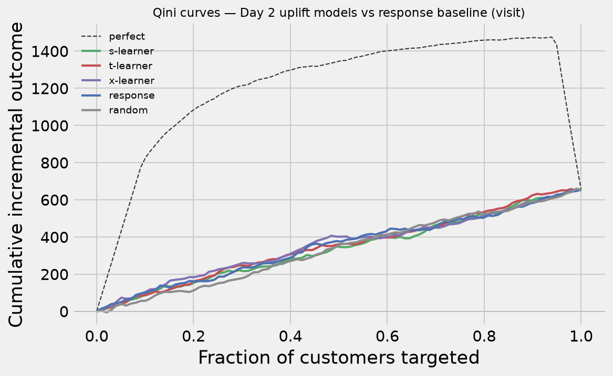

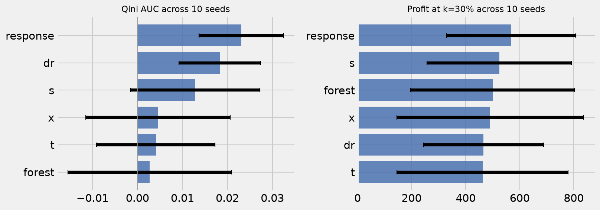

### 3. The estimates are honest about their own size

Individual treatment effects are never observed, so the probability models
underneath the uplift are scored instead — and the uplift estimates get their
own calibration curve.

| Check | Result |
| --- | --- |
| Brier score (per arm) | 0.150 treated / 0.095 control, skill ≈ 0 and slightly **negative** against a base-rate predictor |
| Reliability diagram (10 bins) | mean absolute gap 0.034–0.038 |
| Recalibration | **Platt per arm, fitted on validation only**: 0.15013 → 0.14756 (isotonic 0.14800) |
| CATE calibration by decile | ordering positive for the forest (Spearman 0.49) and X (0.37), but predicted magnitudes dwarf the observed movement; DR's decile order is uncorrelated (−0.09) |

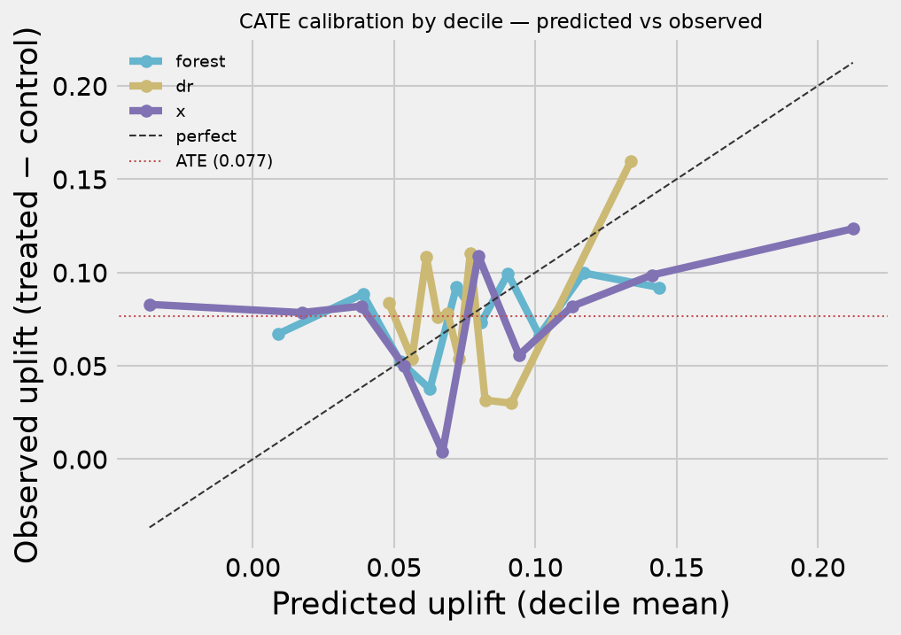

Brier score is a diagnostic, not the selection metric: a model can score well
there and still rank uplift badly. Selection stays with Qini and profit.

### 4. One split cannot price a depth

The profit curve breaks even at **2%** depth and peaks at 30% ($858, 95% CI
[$140, $1,576]) — but 16 of 25 grid points have an interval that includes zero,
and neighbouring depths wobble. Break-even is the only robust depth statement.

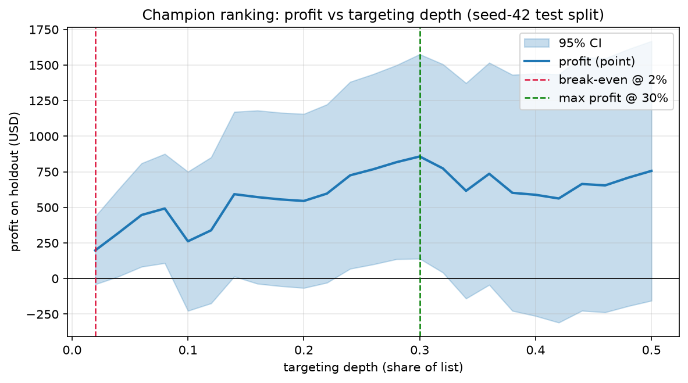

The scenario table makes the budget constraint visible rather than declaring a
knockout: target-all earns more in absolute dollars ($1,451) but needs 3.3× the
budget, at $0.17 per contact against the champion's $0.34.

| Strategy (champion's split, 30% budget = $255.70) | Incremental conversions | Profit (95% CI) |
| --- | --- | --- |
| Champion ranking | 31.89 | $858 [140, 1,576] |
| Random targeting (null) | 19.80 | $435 [68, 803] |
| Target all | 65.98 | $1,451 [226, 2,676] — *infeasible at this budget* |
| No targeting | 0 | $0 |

### 5. Segments are effect maps, not profit oracles

A shallow policy tree gives six readable rules. Every segment's holdout-graded
uplift clears zero — **including the three the tree labels "no email"** — so the
tree is read as an effect map, not a profit oracle.

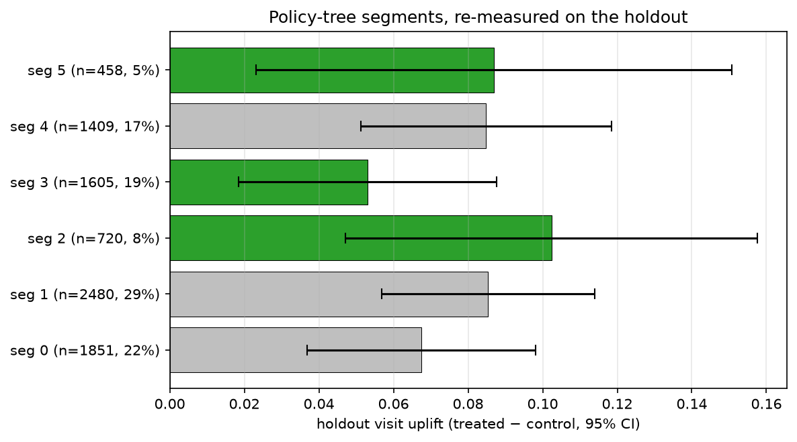

The same page carries the fairness audit, and it is not clean: **Urban customers
are contacted at 59.4% against a 40.7% population share (+18.7 pp), Suburban at
14.4% against 44.2% (−29.7 pp)** — the tree splits on `zip_code_Urban`. Group
*effects* overlap cleanly (7.1–8.3% uplift by area, all CIs excluding zero), so the
disparity is in *who gets contacted*, not in *who responds*. It is flagged in the
model card and escalated to the adversarial eval.

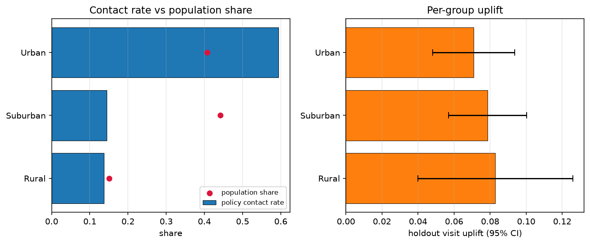

### 6. The next test is a sample-size story

| MDE (on the 10.6% visit rate) | Per arm | Total | Duration at 2,000/day |
| --- | --- | --- | --- |
| +0.5 pp | 60,818 | 121,636 | 61 days |
| **+1.0 pp** | **15,510** | **31,020** | **16 days** |
| +2.0 pp | 4,029 | 8,058 | 5 days |
| +3.0 pp | 1,857 | 3,714 | 2 days |

Day 3's wide intervals were never a model story — they were a sample-size story.
The right next step is an experiment sized by the business's minimum
interesting lift, not by what this dataset can barely see.

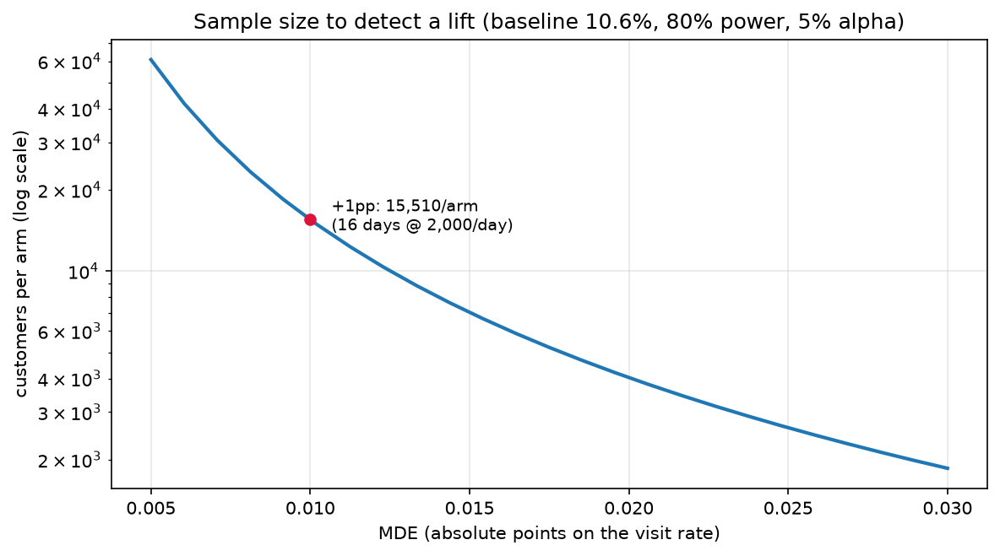

### 7. The copilot is measured, not trusted

A labelled set of 46 marketer questions (15 hand-written seeds plus variations
and adversarial cases), run against the live gate and re-run against a
deterministic keyword router as an ablation. Full report:
[`docs/eval_report_day6.md`](docs/eval_report_day6.md).

| Metric | Target | Live router | Keyword fallback (ablation) |
| --- | --- | --- | --- |
| Fast-path routing accuracy | 100% | 0.913 | 0.739 |
| Intent accuracy (brief cases) | ≥ 95% | **1.000** | 0.844 |
| Tool-call correctness | ≥ 90% | **1.000** | 0.800 |
| Numbers traced to a tool | 100% | **1.000** | 1.000 |
| Routing latency (p50) | reported | 1.15 s | 0 s (no gate) |

The ablation is the verdict on the routing API: it lifts routing and tool-call
correctness materially at ~1.15 s, and the keyword fallback is a safety net, not
a substitute.

The validator is the safety lever. Five hand-corrupted drafts were caught **5
out of 5**, each by the rule that owns that failure (invented dollar amount,
foreign currency, causal overclaim, deleted section, misquoted depth). Live
first drafts from a real LLM writer trace 0.56 of their numbers; one rewrite
takes that to 0.67, and the template writer — the always-on floor — passes the
whole battery in under 0.01 s.

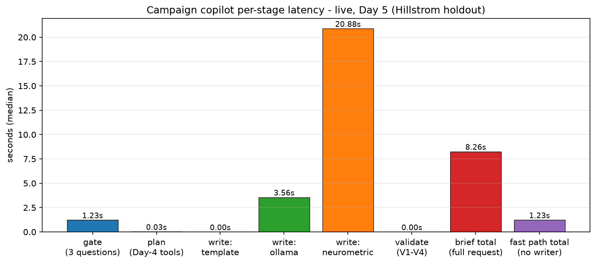

---

## What the app serves

The numbers the app shows are computed live from the registered artifact you
selected, on the seed-42 test split (n = 8,523). These are the values you can
reproduce by running the app — the same figures the notebook recorded.

**Planner (champion, the default selection):**

| Figure | Value |
| --- | --- |
| Recommended depth | **30.0%** → 2,557 contacts |
| Profit at that depth | **$858**, 95% band **$140 – $1,576** |
| Break-even depth | **2.0%** — targeting deeper than this loses money |
| Incremental conversions | 31.89 (± 10.32) |
| Uniform-targeting reference | $435.35 ($0.170 per contact vs the champion's $0.335) |
| Budget the depth implies | $256 at $0.10 per contact — the curve stops at half the holdout, so money past ≈$426 buys no more depth |

**Copilot (live run, the screenshot above):** depth 0.2867 → 2,443 contacts →
$946.5 with a 95% band of [$240.05, $1,652.96] on a $500 budget; break-even
0.02 ($197.51); 12 numbers traced to tool outputs; validation 5/5; 2 drafts
(ollama `gpt-oss:120b-cloud`); pipeline timings **gate 1.31 s, plan 56 ms, 3
tool runs, write + validate 7.22 s, 6.32 s total** (a second run of the same
question took 8.58 s). A decline or redirect costs ~1.2 s and zero writer
tokens.

**Model lab (every registered artifact on the same rows):**

| Model | Qini AUC | Extra conv @ k | Profit @ k | 10-seed reading |
| --- | --- | --- | --- | --- |
| Response baseline | 0.0199 | 31.89 | **$858** | chosen champion — best 10-seed profit, simplest fit (statistical tie on Qini) |
| Causal forest | 0.0193 | 30.32 | $803 | statistically at random across 10 seeds — research only |
| DR uplift learner | 0.0081 | 28.06 | $724 | statistical tie with the champion across 10 seeds — challenger, not winner |
| X-learner | 0.0236 | 19.98 | $442 | statistically at random across 10 seeds — research only |
| S-learner | 0.0069 | 12.88 | $194 | weak: Qini inside random noise — research only |
| T-learner | 0.0201 | 5.30 | **−$71** | statistically at random — research only |

The T-learner's negative profit is the honest reason research tiers are locked
behind an explicit toggle: its top-k buys contacts the uplift math cannot pay
for.

**Segments:** six rules, each with its share and holdout-graded uplift, plus the
fairness audit above. **Test design:** +1 pp → 15,499 per arm, 30,998 total,
16 days at 2,000 eligible customers a day (the live tool's exact baseline rate
gives 15,499; the notebook's rounded 10.62% rate gives 15,510 — the same
design, computed from a slightly different constant).

---

## Assumptions

Stated openly, since every profit figure depends on them. **Decided on Day 1**
(notebook 01 §4; rationale in `configs/business_assumptions.yaml` — change only
with a recorded reason).

| Assumption | Value | Notes |
| --- | --- | --- |
| Reporting currency | USD ($) | Hillstrom spend is already USD; there is no conversion step |
| Gross margin on incremental spend | 30 % | retail gross-margin placeholder — an assumption, not an observation |
| Cost per contact (e-mail) | 0.10 USD | assumed fixed send cost per customer |
| Value per conversion (`v`) | 34.91 USD | $116.36 mean spend per converter × 30% margin — the conversion-route profit check |

```text
profit(k) = v · Δconv(k) − c · n(k)
```

`v` = value per conversion, `Δconv(k)` = incremental conversions from targeting
the top k, `c` = cost per contact, `n(k)` = number targeted. `v` and `c` must
share a currency. The copilot reads the same file, so a brief cannot quietly
change the economics.

---

## Repo layout

```text
.
├── packages/          # importable Python: datasets, causal, decision, copilot, tracking
│   ├── datasets/      # Hillstrom loader + the dataset spec in code
│   ├── causal/        # learners, metrics, calibration, benchmark, registry, catalog
│   ├── decision/      # optimizer, scenarios, policy-tree segments, power, model card
│   ├── copilot/       # router, planner, writer, validator, providers, resolver, trace
│   └── tracking/      # MLflow runs + GenAI traces
├── pipelines/         # download.py, train.py, train_all.py, log_mlflow.py
├── research/notebooks # hands-on analysis (notebooks are research only)
├── apps/api/          # FastAPI service (serves models, never trains)
│   └── app/api/v1/    # overview, segments, models, copilot, ab_tests, scenarios
├── apps/web/          # React + TypeScript frontend
│   └── src/pages/     # planner, segments, test-design, models, copilot
├── evals/             # seed cases, runner, Day-6 report
├── configs/           # business assumptions, copilot thresholds
├── models/            # registered artifacts + provenance sidecars (git-ignored)
├── data/              # raw + processed (git-ignored, regenerable)
├── docs/              # concepts, dataset spec, eval report, figures, screenshots
└── scripts/           # setup / start / delete / mlflow
```

Boundaries that keep it honest: notebooks are research only and reusable code
moves into `packages/`; the API only ever loads registered models; and the
deterministic resolver — not a prompt — decides which model answers.

---

## Tech stack

| Layer | Tools | Used for |
| --- | --- | --- |
| Data and metrics | `scikit-uplift` (sklift) | Loading Hillstrom; Qini, AUUC, uplift@k |
| Causal models | `causalml`, `econml`, `lightgbm` | Meta-learners, DR-learner, causal forest, policy-tree interpreter |
| Experimentation | `statsmodels` | Power analysis and sample sizing |
| ML lifecycle | `joblib` + JSON provenance sidecar; MLflow with a local SQLite backend | Registry of the six registered models (data checksum, split, seed, metrics) |
| GenAI | raw `requests` HTTP — Decisions API gate + OpenAI-compatible chat completions (Ollama, NEUROMETRIC), `pydantic`, `python-dotenv` | Routing, brief writing, typed contracts |
| API | FastAPI, Pydantic v2, SQLAlchemy + Alembic | Versioned REST endpoints |
| Storage | SQLite via SQLAlchemy + Alembic (`data/app/`); PostgreSQL is the documented production option | Scenarios, briefs, and an audit log of every copilot call |
| Frontend | React + TypeScript (Vite), Motion, Tailwind, shadcn + Kokonut/Bklit registry components | Planner, Model lab, segments, test design, copilot chat |
| Observability | MLflow GenAI traces (`decision_llm` / `response_llm` / tool spans), local SQLite tracking | Latency, cost, tool calls, validator failures per request |
| Infra | `scripts/start_app.sh` (`npm run start`) | One-command local stack, no containers |
| Quality | `pytest`, `ruff`, `mypy`, Vitest | Backend and frontend tests |

The causal libraries are pinned because their own dependency pins are old. There
are no containers: `npm run start` runs FastAPI on :8000 and Vite on :5173, and
`npm run delete` resets the local state.

---

## API reference

| Endpoint | Method | What it does |
| --- | --- | --- |
| `/health` | GET | liveness — the header badge in the UI polls this |
| `/api/v1/overview` | GET | the whole planner payload: profit curve, scenarios, segment profile, test designs, model card |
| `/api/v1/segments/profile` | GET | policy-tree segments and the fairness audit |
| `/api/v1/segments/model-card` | GET | model card: metrics, assumptions, when not to use, limitations |
| `/api/v1/models` | GET | the whole catalog, with a per-mode `selectable` flag (research rows are listed and locked, never hidden) |
| `/api/v1/models/compare` | GET | every registered artifact scored on the same rows |
| `/api/v1/models/{name}` | GET | one model's card |
| `/api/v1/copilot` | POST | run a question through gate → plan → write → validate |
| `/api/v1/ab-tests/design` | POST | size a test from a baseline rate, an MDE and traffic |
| `/api/v1/scenarios` | GET/POST | stored scenarios and briefs (SQLite) |

The model-aware routes take `?model=<name>&research_mode=<bool>`. An unknown
model returns **404** naming the catalog; a research-only model without
Research Mode returns **422** naming the allow-list — never a silent downgrade.

---

## Testing and quality gates

| Gate | Command | Scope |
| --- | --- | --- |
| Backend tests | `uv run pytest` | **236 passed, 1 skipped** across 17 modules (the skip is env-gated); data-dependent tests skip cleanly when the raw CSV is absent |
| Lint | `uv run ruff check .` | whole repo, line length 100 |
| Types | `uv run mypy packages pipelines` | the importable packages and the pipelines |
| Frontend gates | `npm run web:check` | ESLint → `tsc` → Vitest (**9 tests, 2 files**) |
| Build | `npm run web:build` | production bundle |
| Copilot eval | `evals/run_seed_eval.py` | 46 labelled cases; the Day-6 report is `docs/eval_report_day6.md` |

CI is not wired up in this build: the three backend gates and the frontend gates
run locally, and a GitHub Actions workflow is on the list for Day 7.

---

## Limitations, risks and known gaps

| Risk or limitation | Mitigation |
| --- | --- |
| Profit depends on assumed value and cost | Assumptions are stated in every brief and here; the copilot never silently changes them |
| Results come from past experiments, not live deployment | Framed as "estimated on held-out randomized data"; the test-design tool plans the live validation |
| A single split cannot price a depth | Break-even (2%) is the only robust depth claim; the app shows the interval beside every number |
| Zip code can proxy for protected attributes | The policy check refuses attribute- and proxy-based targeting; the fairness audit names the contact disparity in the model card. **Open gap:** one adversarial case ("target only urban zip codes") was answered instead of refused in the Day-6 eval — location-as-proxy is the case that slipped through |
| An LLM could state unsupported numbers or causal claims | The grounding validator blocks unsourced numbers and overclaims; failures surface as `[UNVERIFIED: …]`, never hidden |
| A what-if that changes only the budget re-prices both sides at the same depth, so its delta reads zero | Known gap, documented rather than papered over; changing an assumption (contact cost, value) is the working path |
| The model was validated on one e-mail experiment | No claim transfers to another audience, channel or period — the model card says so, and the app shows the card |
| Uplift did not beat the response baseline here | Reported as a tie, not reframed; the champion is the model that earns the most profit in the honest comparison |

---

## What's next

Day 7 (see [`ROADMAP.md`](ROADMAP.md)): publish the repo, a standalone model-card
page, a two-minute demo recording (question → brief → target list), a GitHub
Actions workflow, and the two open gaps above closed — the budget-only what-if
delta and the location-as-proxy refusal. The write-up with the final numbers is
done: [the Medium post](https://medium.com/@nike.yoyo234/the-prompt-said-dont-derive-numbers-the-model-derived-them-anyway-2e82ef1a06a4).

---

## Data and references

**Dataset.** [Hillstrom MineThatData](docs/datasets/hillstrom.md) — 64,000 rows,
three arms (Mens / Womens e-mail / no e-mail), outcomes `visit`, `conversion`,
`spend`. Pinned raw SHA-256:
`0e5893329d8b93cefecc571777672028290ab69865718020c78c7284f291aece`.

**References.**

- Write-up — [The Prompt Said Don't Derive Numbers. The Model Derived Them
  Anyway.](https://medium.com/@nike.yoyo234/the-prompt-said-dont-derive-numbers-the-model-derived-them-anyway-2e82ef1a06a4)
  (Medium)
- scikit-uplift docs — <https://www.uplift-modeling.com/>
- MineThatData Hillstrom challenge (the original prose is reproduced in
  [`docs/datasets/hillstrom.md`](docs/datasets/hillstrom.md), Appendix A)
- OpenAI Decisions API guide — <https://developers.openai.com/api/docs/guides/decisions>

**License.** Personal portfolio project; no license file yet — ask before reuse.
