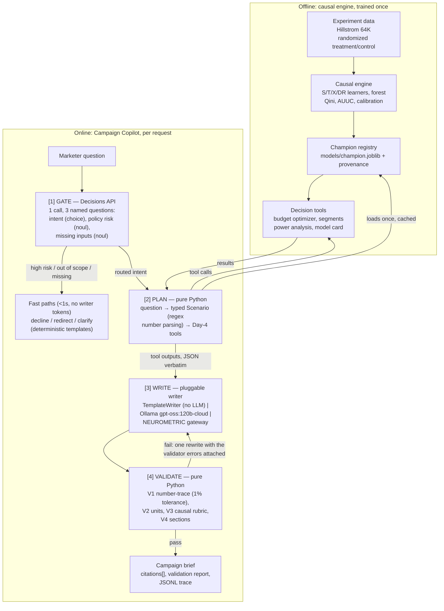

# UpliftIQ — Causal Promo Targeting with a GenAI Campaign Copilot

Oct 17, 2026 · @Alpha

## Overview

UpliftIQ decides who should receive a discount by estimating each customer's incremental response to it, then lets a marketer plan a campaign in plain language through a grounded GenAI copilot.

**The problem.** E-commerce and fintech companies spend heavily on coupons, cashback and promotions. Much of that money goes to customers who would have bought anyway ("sure things"), and some goes to customers a promo actively puts off ("sleeping dogs"). Standard response models, such as click or conversion prediction, cannot tell these groups apart from the customers a promo actually persuades.

**The solution.** UpliftIQ has three layers:

1. **Causal engine.** Uplift models trained on real randomized experiments estimate the conditional average treatment effect (CATE) for each customer.
2. **Decision layer.** A budget optimizer turns those estimates into a target list that maximizes incremental profit under a budget, and an A/B test designer plans the next experiment.
3. **Campaign Copilot.** A GenAI layer lets a non-technical marketer ask questions in plain language. It calls the deterministic tools above, never invents a number, and writes a campaign brief whose every figure is checked against tool outputs.

**Headline results (fill in after the build).**

| Metric | Response model (baseline) | Best uplift model |
| --- | --- | --- |
| Qini AUC |  |  |
| Incremental conversions at 30% targeted |  |  |
| Incremental profit per $100 of spend (stated assumptions) |  |  |
| Copilot numeric faithfulness (% of figures traced to tools) | — |  |

## Why it matters

Targeting by response score spends budget on people who would convert anyway; targeting by uplift spends it only where it changes behavior.

Every customer falls into one of four groups for a given promo:

| Group | Buys without promo? | Buys with promo? | Should get the promo? |
| --- | --- | --- | --- |
| Persuadables | No | Yes | Yes, the only group that creates incremental value |
| Sure things | Yes | Yes | No, the discount is wasted margin |
| Lost causes | No | No | No, the contact cost is wasted |
| Sleeping dogs | Yes | No | No, the promo causes harm |

A response model ranks sure things highest, because they have the highest conversion probability. An uplift model ranks persuadables highest, because it estimates the difference the promo makes. The project's central comparison is exactly this: the same budget allocated by response score versus by uplift score.

Indian fintech companies such as Paytm, PhonePe and CRED, and e-commerce companies such as Flipkart and Meesho, run cashback and coupon targeting at scale, so the method maps directly to real budgets. It also demonstrates skills that are rare in junior portfolios: causal inference, experiment validation, and decision-making under constraints.

## Datasets

The project runs on one public randomized experiment, **Hillstrom MineThatData**, which carries the profit story because it records real spend.

| Dataset | Rows | Treatment | Outcomes | Features | Role in project |
| --- | --- | --- | --- | --- | --- |
| [Criteo Uplift v2.1](https://arxiv.org/abs/2111.10106) | 13,979,592 users | Ad exposure, 85% treated / 15% control | visit (about 4.7%), conversion (about 0.29%) | 12 anonymized (f0–f11) | Scale benchmark (not used in this build) |
| Hillstrom MineThatData | 64,000 customers | Men's email / women's email / no email | visit, conversion, spend | Interpretable: recency, history, channel, zip type | Profit, explainability, copilot demos |

**Hillstrom notes.** Use one email arm versus no email as the main binary experiment, and check the observed lift of each arm on day 1 before choosing. The three arms also allow a "which email, if any?" multi-treatment extension. Spend gives real revenue, so profit needs only an assumed margin and contact cost.

## System architecture

The causal engine is trained offline once; the copilot runs per request and can reach a number only by calling the decision tools.

The architecture as a Mermaid diagram (renders on GitHub and in most Markdown viewers):



A request flows from the marketer's question through the gate, plan, write and validate stages before it returns as a brief. Gate-only paths (decline, redirect, clarify) never touch a writer and spend zero writer tokens; a full brief is the only path that generates prose, and the only path to a figure is the tool call up to the offline engine.

## Causal ML pipeline

Six stages turn raw experiment data into a budget-constrained target list and a plan for the next test.

1. **Validate the experiment.** Compare feature distributions between treatment and control using standardized mean differences (flag any SMD above 0.1). Compute the average treatment effect with a confidence interval; every model must beat random targeting against this number.
2. **Model the uplift.** Train a naive response model (classifier on treated users only, the CTR-style baseline), then S-, T-, X- and DR-learners and a causal forest, all with LightGBM base learners where applicable.
3. **Evaluate properly.** Use Qini curves, AUUC, uplift@k and CATE calibration by decile (predicted versus observed uplift per bucket), plus Brier score and calibration curves for the underlying outcome models. Repeat across seeds and splits to report stability, not a single lucky run.
4. **Optimize the budget.** Given budget, contact cost and value per conversion, rank customers by expected incremental profit and target down the list until the budget runs out or marginal profit turns negative. Compare against targeting everyone, random targeting and response-score targeting.
5. **Interpret the segments.** Fit a shallow policy tree on the CATE estimates (EconML's `SingleTreeCateInterpreter`) to produce readable rules, such as "recent buyers with web channel history". These rules are the grounded source for the copilot's segment explanations.
6. **Design the next test.** Use a power analysis to size a follow-up A/B test: the minimum detectable effect, sample size and duration for a given traffic level. This closes the loop from analysis to experimentation.

The profit formula used throughout:

```latex
\text{profit}(k) = v \cdot \Delta\text{conv}(k) - c \cdot n(k)
```

Here v is the value per conversion, Δconv(k) the incremental conversions from targeting the top k customers, c the cost per contact, and n(k) the number targeted. On Hillstrom, v comes from real spend; the margin-route alternative multiplies incremental spend by the gross margin.

## GenAI layer: Campaign Copilot

The copilot translates a marketer's plain-language question into a precise scenario, runs the deterministic causal tools, and writes a brief in which every number is verified against tool outputs. The rule is simple: **the LLM translates and narrates; the tools compute.**

### The gap it closes

The causal engine outputs CATE scores and profit curves. A marketer's real question sounds like: "I have $500, each contact costs $0.10, skip anyone who bought last week. Who do I target, and is it worth it?" Turning that into optimizer inputs, then turning the result back into a decision someone can approve, is the work the copilot does. Without it, the models stay in a notebook.

### Four use cases

| Use case | Example question | Tools called | Output |
| --- | --- | --- | --- |
| Plan a campaign | "$500 at $0.10 per contact: who should get it?" | `optimize_budget`, `compare_scenarios`, `profit_point` | Brief, profit vs. baselines, intervals |
| What-if | "What if contact cost rises to $0.60?" | `compare_scenarios` (base + variant) | Side-by-side change in reach and profit |
| Explain segments | "Who are the persuadables, and who should we avoid?" | `get_segment_profile` | Policy-tree rules in plain language, with size and effect intervals |
| Design the next test | "How long to test a new offer? We see 2,000 customers a day." | `design_ab_test` | Test plan: sample size per arm, duration, success metric |

### Request flow

1. **Gate (Decisions API, one call).** Three named questions: a *choice* for intent (plan, what-if, explain, test design, out-of-scope); a *noul* predicate for policy risk (does the request target or exclude people by a sensitive attribute or a proxy for one?); and a *noul* predicate for missing inputs (is a required parameter absent?). Probabilities are thresholded (`configs/copilot.yaml`): high policy risk is declined with a fixed explanation, out-of-scope or low intent confidence gets a short redirect, missing inputs trigger exactly one clarifying question — all deterministic templates, no writer tokens, so these fast paths stay sub-second.
2. **Plan (pure Python).** The routed intent plus a deterministic number parser (dollar amounts, percentages, per-contact costs, daily volumes — commas and `k` suffixes handled) fill a typed `CampaignScenario`; anything the marketer did not state is filled from documented defaults and flagged in `assumptions_used`. The planner dispatches to the Day-4 tools over the registered champion loaded once and cached; a failing tool surfaces as a typed `ToolFailure` the writer can quote but never paper over.
3. **Write (pluggable writer).** The writer sees only the scenario and tool outputs, never raw data. Providers are thin raw-HTTP clients: `TemplateWriter` (no LLM, always available), Ollama (`gpt-oss:120b-cloud`) and the NEUROMETRIC gateway — selected in `configs/copilot.yaml`, swappable per request. The prompt pre-computes every number and instructs verbatim citation.
4. **Validate (pure Python, no LLM).** Deterministic checks run before the user sees anything (next subsection). A failed check triggers one rewrite with the errors attached; a second failure returns the brief with explicit `[UNVERIFIED: …]` flags instead of silently passing.

### Tools

| Tool | Inputs | Returns |
| --- | --- | --- |
| `optimize_budget` | budget, cost per contact, value per conversion, exclusions | customers targeted, incremental conversions and profit (with intervals), baseline comparison, target list ID |
| `compare_scenarios` | two scenarios | change in reach, conversions and profit |
| `get_segment_profile` | segment (top-k, persuadables, sleeping dogs) | policy-tree rules, size, mean CATE with interval, feature summary |
| `design_ab_test` | baseline rate, minimum detectable effect, alpha, power, daily traffic | sample size per arm, days needed |
| `get_model_card` | none | model used, validation metrics, data source, known limits |

### Grounding validator

- **Numeric faithfulness (V1).** Every dollar amount, percentage and unit-tagged count in the brief is extracted with a parser and matched against the flattened tool outputs, with a 1% relative tolerance for rounding (depths and rates also match their fraction/percent forms). Any number with no source fails the check; each matched number becomes a `Citation` with its tool-output path.
- **Units (V2).** USD everywhere: a brief containing ₹, INR, €, "lakh" or "crore" fails — the reporting currency was decided on Day 1 and the validator enforces it.
- **Required content (V4).** Per intent, the brief must carry its sections — recommendation, what it earns, uncertainties, assumptions (plus a next-test pointer where relevant) — state its assumptions, and show intervals for the main estimates.
- **Causal language (V3).** A deny-list rubric blocks overclaims ("will buy", "guaranteed", "proves", "because they are …"): segment rules describe *who responds more*, not *why*, and a policy tree shows heterogeneity, not mechanism. When a tool output carries an interval, the prose must contain interval phrasing.

### What the copilot deliberately does not do

- It never calculates or estimates a number itself; every figure comes from a tool.
- It never edits the target list; only the optimizer produces it.
- It does not claim that generated ad copy will perform. If a marketer asks for message variants, the copilot drafts them only as arms for the next A/B test, sized by `design_ab_test`, because offline data cannot measure the effect of new copy.

### Why use the Decisions API for routing

The planner LLM could route on its own. The Decisions API is used because routing and policy checks run on every request, and it returns calibrated probabilities that can be thresholded and audited at low cost and latency. Whether it earns its place is measured, not assumed: the evaluation includes an ablation with and without the router — the no-Decisions path is a deterministic keyword scorer (`keyword_fallback_route`), not another model. If the endpoint is unreachable or refuses a question, the keyword fallback keeps the copilot answering, with `router=keyword_fallback` recorded in the trace. All provider calls are thin `requests` code behind small classes, so the copilot still works if an API changes.

## Evaluation plan

Both layers are judged on measurable targets: the causal engine against baselines on held-out experiment data, and the copilot against a labelled test set of marketer questions.

**Causal engine.**

| Metric | What it shows | Target |
| --- | --- | --- |
| Qini AUC / AUUC | Ranking quality for incremental response | Best uplift model beats the response model and random |
| Uplift@k (10%, 30%) | Lift captured in the top of the ranking | Higher than response-score targeting |
| CATE calibration by decile | Predicted vs. observed uplift per bucket | Monotonic, close to the diagonal |
| Incremental profit at fixed budget | Business value under stated assumptions | Beats target-all and response-score targeting |
| Stability across seeds and splits | Results are not one lucky run | Report mean and spread |

**Outcome-model calibration.** Individual treatment effects are never observed, so Brier score and calibration curves cannot score uplift directly. They score the probability models underneath it. A T-learner's uplift is the difference of two predicted probabilities, and the optimizer multiplies that difference by value per conversion, so a miscalibrated outcome model distorts every profit figure even when the ranking is good.

| Check | Applied to | Purpose |
| --- | --- | --- |
| Brier score | Treated and control outcome models separately; the response baseline | Accuracy of predicted probabilities, compared with a base-rate predictor |
| Calibration curve (reliability diagram) | Same models, 10 quantile bins on held-out data | Shows over- or under-confidence by probability range |
| Recalibration (isotonic or Platt) | Any outcome model whose curve departs from the diagonal | Fitted per arm on a validation split, never on the test split |
| CATE calibration by decile (above) | The uplift estimates | The uplift equivalent of a calibration curve |

Brier score is a diagnostic, not the model-selection metric: a model can have a good Brier score and still rank uplift poorly. Model choice stays with Qini AUC and incremental profit.

**Campaign Copilot.** `evals/seed_cases.yaml` starts with 15 hand-written questions, each labelled with the expected route (intent + fast path) and, for brief cases, the expected tool calls; Day 6 grows it to ~50 with adversarial ones (fake numbers in the prompt, proxy-attribute targeting).

| Metric | How it is measured | Target |
| --- | --- | --- |
| Intent routing accuracy | Router choice vs. label | ≥ 95% |
| Scenario extraction accuracy | Exact match per field (budget, cost, exclusions) | ≥ 95% per field |
| Tool-call correctness | Right tools with right arguments | ≥ 90% of cases |
| Numeric faithfulness | Share of brief numbers traced to tool outputs | 100% after the validator |
| Correct declines | Policy-risk and out-of-scope cases handled correctly | 100% |
| Latency and cost per brief | p50/p95 seconds, USD per brief | Reported, with and without the router |

Most copilot checks are deterministic, not LLM-judged; only the causal-language check uses a judge. The router ablation reports whether the Decisions API improves latency, cost or decline accuracy enough to justify itself.

## Tech stack and repo structure

A Python backend and ML packages behind a FastAPI service, with a React frontend; the causal libraries are pinned because their dependency pins are old.

| Layer | Tools | Used for |
| --- | --- | --- |
| Data and metrics | `scikit-uplift` (sklift) | Loading Hillstrom; Qini, AUUC, uplift@k |
| Causal models | `causalml`, `econml`, `lightgbm` | Meta-learners, DR-learner, causal forest, policy-tree interpreter |
| Experimentation | `statsmodels` | Power analysis and sample sizing |
| ML lifecycle | MLflow | Experiment tracking, model registry; the API loads only the registered champion |
| GenAI | raw `requests` HTTP — Decisions API gate + OpenAI-compatible chat completions (Ollama, NEUROMETRIC), `pydantic`, `python-dotenv` | Routing, brief writing, typed contracts |
| API | FastAPI, Pydantic v2, SQLAlchemy + Alembic | Versioned REST endpoints; copilot responses streamed over SSE |
| Storage | PostgreSQL | Scenarios, briefs, target lists, and an audit log of every LLM call and tool output |
| Frontend | React + TypeScript (Vite), TanStack Query, Recharts, Tailwind | Campaign planner, profit and Qini charts, segment explorer, copilot chat |
| Observability | Structured logging, Langfuse (or OpenTelemetry) | Traces of copilot requests: latency, cost, tool calls, validator failures |
| Infra and CI | Docker Compose, GitHub Actions | One-command local stack; lint, type checks, tests and an eval smoke run on every push |
| Quality | `pytest`, `ruff`, `mypy`, Vitest | Backend and frontend tests; the copilot eval as a CI gate |

```
upliftiq/
├── apps/
│   ├── api/                      # FastAPI service (serves models, never trains)
│   │   ├── app/
│   │   │   ├── main.py
│   │   │   ├── api/v1/           # scenarios, segments, ab-tests, copilot (SSE)
│   │   │   ├── core/             # settings, logging, auth
│   │   │   ├── db/               # SQLAlchemy models, Alembic migrations
│   │   │   └── services/         # thin layer over the packages below
│   │   └── tests/
│   └── web/                      # React + TypeScript (Vite)
│       ├── src/
│       │   ├── pages/            # Planner, Segments, Test design, Copilot
│       │   ├── components/       # charts, tables, brief viewer
│       │   ├── api/              # typed client generated from the OpenAPI spec
│       │   └── hooks/
│       └── tests/
├── packages/                     # installable Python libraries
│   ├── causal/                   # learners, metrics, calibration
│   ├── decision/                 # optimizer, power analysis, policy-tree segments
│   └── copilot/                  # router, planner, tools, writer, validator, providers
├── data/                         # git-ignored; rebuilt by pipelines/download.py
│   ├── raw/                      # Hillstrom download, untouched
│   └── processed/                # cleaned, split Parquet files
├── pipelines/
│   ├── download.py               # fetches the raw datasets and checksums them
│   ├── train.py                  # trains, logs to MLflow, registers the champion
│   └── evaluate.py               # benchmark tables, calibration reports
├── research/notebooks/           # hands-on analysis: EDA, models, decision layer
├── evals/                        # copilot_cases.jsonl, runner, reports
├── configs/                      # model and business-assumption YAML
├── infra/
│   ├── docker/                   # Dockerfiles for api and web
│   └── docker-compose.yml        # web, api, postgres, mlflow
├── .github/workflows/ci.yml      # lint, type-check, tests, eval smoke run
├── docs/                         # model card, architecture decision records
└── README.md
```

Three boundaries keep it production-shaped. Notebooks are for research only; anything reused moves into `packages/`. Training runs as a pipeline that registers a model in MLflow, and the API only loads the registered version. The frontend uses a client generated from the API's OpenAPI spec, so backend schema changes surface as TypeScript errors instead of runtime bugs.

## Seven-day build plan

The causal engine is finished by day 4 so the copilot is built on stable tools, not moving ones.

| Day | Focus | Done when |
| --- | --- | --- |
| 1 | Data, randomization checks, ATE, repo and README skeleton | SMD table and ATE with intervals |
| 2 | Response baseline and S/T/X learners | Qini curves for all models on Hillstrom |
| 3 | DR-learner, causal forest, calibration, stability runs | Benchmark table with mean and spread across seeds |
| 4 | Budget optimizer, profit curves, policy-tree segments, power analysis | All five copilot tools callable and unit-tested |
| 5 | Copilot: router, planner, writer, grounding validator | End-to-end brief for the four use cases |
| 6 | Copilot eval set and ablation; React frontend and FastAPI service | Eval report with all copilot metrics |
| 7 | README results, model card, demo video | Headline results table filled in |

## Getting started

The first script loads Hillstrom, trains a T-learner and the response baseline, and compares them on the same Qini metric.

```python
from packages.datasets.hillstrom import fetch_hillstrom
from causalml.inference.meta import BaseTClassifier
from sklift.metrics import qini_auc_score, uplift_at_k
from sklearn.model_selection import train_test_split
from lightgbm import LGBMClassifier

# binary arm: Mens E-Mail vs No E-Mail, target = visit
df = fetch_hillstrom(target="visit", treated_arm="mens")
X = df.drop(columns=["visit", "conversion", "spend", "segment", "treatment"])
y, t = df["visit"], df["treatment"]

strat = y.astype(str) + "_" + t.astype(str)
X_tr, X_te, y_tr, y_te, t_tr, t_te = train_test_split(
    X, y, t, test_size=0.3, stratify=strat, random_state=42)

# Uplift: T-learner
tm = BaseTClassifier(LGBMClassifier(), LGBMClassifier())
tm.fit(y_tr.values, t_tr.values, X=X_tr.values)
uplift = tm.predict(X_te.values)

# Baseline: response model trained on treated users only
resp = LGBMClassifier().fit(X_tr[t_tr == 1], y_tr[t_tr == 1])
resp_score = resp.predict_proba(X_te)[:, 1]

for name, score in [("T-learner", uplift), ("Response model", resp_score)]:
    print(name,
          "Qini AUC:", round(qini_auc_score(y_te, score, t_te), 4),
          "Uplift@30%:", round(uplift_at_k(y_te, score, t_te,
                                           strategy="overall", k=0.3), 4))
```

The copilot's contract is a typed scenario, so a question can only become fields the tools accept — everything else is a validation error, not a guess:

```python
from pydantic import BaseModel, Field

class CampaignScenario(BaseModel):          # packages/copilot/schemas.py
    intent: Literal["plan", "what_if", "explain", "test_design"]
    question: str
    budget_usd: float | None = Field(default=None, gt=0)
    cost_per_contact_usd: float | None = Field(default=None, gt=0)
    depth: float | None = Field(default=None, gt=0, le=0.5)
    mde: float | None = Field(default=None, gt=0)
    daily_eligible: int | None = Field(default=None, gt=0)
    assumptions_used: list[str] = []        # every default, shown in the brief
```

**Day 1 checklist.**

- [ ] Create a fresh environment and pin library versions.
- [ ] Check randomization with standardized mean differences for both datasets; flag any SMD above 0.1.
- [ ] Compute the ATE with a confidence interval for each outcome.
- [ ] Write down the profit assumptions (value per conversion, cost per contact, currency) in the README.
- [ ] Set up the repo structure and an empty headline results table.

## Risks, limitations and references

The main limits are about what offline experiment data can prove; each is stated in the README rather than hidden.

| Risk or limitation | Mitigation |
| --- | --- |
| Profit depends on assumed value and cost | State assumptions in the brief and README; show profit across a range of values |
| Hillstrom spend is in USD | Reporting currency is USD only (decided Day 1); the validator fails any brief that mixes currencies |
| Results are from past experiments, not live deployment | Frame impact as "estimated on held-out randomized data"; the test-design tool plans the live validation |
| Decisions API is in public beta | Thin provider class; a deterministic keyword-router fallback keeps the copilot answering; router ablation measures its value |
| LLM could state unsupported numbers or causal claims | Grounding validator blocks unsourced numbers; judge rubric flags causal overclaims |
| Zip-code type can act as a proxy for protected attributes | Router policy check, plus a fairness note on how targeting rates differ by zip type |

**References.**

- [scikit-uplift documentation](https://www.uplift-modeling.com/): dataset loaders, metrics, and a guide to meta-learners.
- [OpenAI Decisions API guide](https://developers.openai.com/api/docs/guides/decisions): question types, probabilities and limits.

**Name options.** UpliftIQ (working name), CausalEdge, Incremental Profit Engine.
